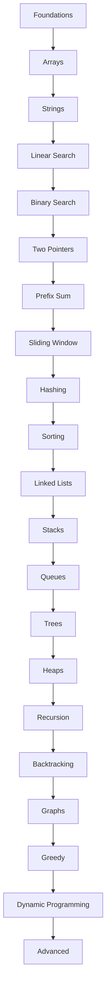

# DSA Curriculum Graph

The curriculum is structured strictly sequentially to ensure foundational mastery before advancing. We only implement topics in small, verified vertical slices to maintain quality.

## Current Implementation Status
* [ ] Foundations
* [ ] Arrays
* [ ] Strings
* [x] Linear Search
* [x] Binary Search
* [ ] Two Pointers
* [ ] Prefix Sum
* [ ] Sliding Window
* [ ] Hashing
* [ ] Sorting
* [ ] Linked Lists
* [ ] Stacks
* [ ] Queues
* [ ] Trees
* [ ] Heaps
* [ ] Recursion
* [ ] Backtracking
* [ ] Graphs
* [ ] Greedy
* [ ] Dynamic Programming
* [ ] Advanced
